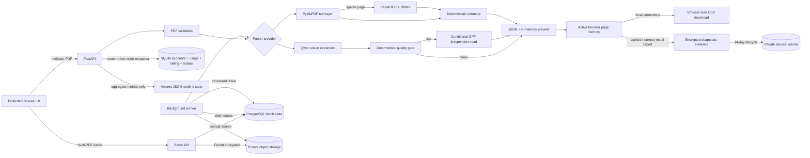

# Architecture

## Scope

ReceiptSift has an indexable public site, a protected single-PDF tool, and a protected limited-retention batch workspace.
Both paths expose encrypted 7-day recent history; batch uploads are processed asynchronously.

## Components

### Browser application

`seo.html`, `seo.css`, and `seo.js` provide the public English-first marketing surface. `index.html`, `styles.css`, and `app.js`
provide the protected bilingual single-PDF tool. `batches.html`, `batch-workspace.css`, and `batch-workspace.js` provide the
English-first bilingual batch ledger with multi-upload, real queue progress, duplicate feedback, exception review, retry, and
unified CSV export.

### API service

`backend/server.py` owns host-aware routing, signed sessions, request validation, security headers, account/billing APIs, quota reservations, privacy-minimized structured logs, single-replica authentication limits, AI spend reservations, receipt parsing, and diagnostic routes. A successful parse response includes a `data:image/png;base64,...` first-page preview, `storage_mode: "recent_7d"`, and an order ID. The server records aggregate usage plus content-free parse-order metadata and stores the owned encrypted recent document.

Owned document read, update, delete, source-PDF, and on-demand CSV routes operate on unexpired encrypted recent history. The unified history route combines single-document and batch results for the account page.

### Parser

`backend/parser.py` validates encryption, page/object/dimension limits, embedded files, and active actions; bounds raster dimensions; extracts text and coordinates; runs local OCR when needed; applies bilingual extraction rules; reconciles totals; and generates preview bytes. `backend/atlas_parser.py` provides the optional primary Qwen path, adaptive image rendering, provider retries, evidence checks, and request-failure fallback. `backend/quality.py` implements deterministic contradictions. `backend/gpt_verifier.py` performs a conditional independent read for risky single-page results; it never silently overwrites extracted fields. Neither path writes the original PDF.

### Runtime safeguards

`backend/runtime_security.py` provides privacy-preserving in-process rate limits, one-line JSON operational events, persistent aggregate provider/parse counters, and conservative daily AI-spend reservations. Its JSON state file lives on the existing volume, contains no receipt content, and does not change SQLite. Because the limiter is process-local, the deployment must stay at one replica.

### Persistent repositories

SQLite stores accounts, hashed authentication tokens, aggregate usage events, billing state, content-free parse orders, diagnostic-case metadata, consented analytics, operational audit records, and abuse controls. The legacy `documents` schema remains migration-compatible but is emptied at startup and receives no new writes.

`backend/diagnostics.py` owns stable extraction digests, the parse-order ledger, encrypted case evidence, user deletion, owner-only evidence access, and retention cleanup. Evidence storage is disabled unless a valid dedicated Fernet key is configured.

`backend/batch_repository.py` stores user-scoped batch and document state in PostgreSQL or local SQLite. `backend/object_store.py`
encrypts source PDFs before writing them to a local private directory or an S3-compatible private bucket.
`backend/batch_worker.py` claims queued documents and persists reviewable results outside the request thread. A separate worker
is started with `python -m scripts.run_batch_worker`.

## Receipt data lifecycle

1. FastAPI reads at most the configured upload limit.
2. The PDF signature, encryption state, page count, object graph, page dimensions, embedded files, and active actions are checked.
3. Parsing/OCR runs in a worker thread.
4. The source PDF, result, and base64 preview are encrypted at rest for the authenticated user with a 7-day expiry.
5. The result and preview are returned to the authenticated browser; document/page usage plus content-free order metadata and input/output SHA-256 digests are committed to SQLite.
6. Corrections update the encrypted recent result, and CSV serialization occurs on demand without retaining a separate export file.
7. The account history can reopen or delete the recent result before automatic expiry.
8. An explicit ledger confirmation copies reviewed structured fields and line items into persistent encrypted storage without copying the source PDF or preview.

If the user explicitly reports an incorrect result, the browser submits the original extraction, current corrections, description, and original uploaded PDF. The server verifies the order ownership, original result digest, and PDF digest, encrypts the evidence, and schedules it for deletion after 14 days. This path is opt-in and is not part of routine parsing.

## Trust boundaries

- Receipt routes and API documentation require a signed account session.
- The browser and API are same-origin; API responses use `Cache-Control: no-store`.
- Uploads are untrusted. Byte signature/size checks occur before PyMuPDF opens them; structural and active-content checks occur immediately after opening and before rendering, OCR, or cloud submission.
- Static file serving uses an explicit allow list and cannot expose the database, environment files, diagnostic evidence, or backend source.
- Diagnostic evidence requires a dedicated encryption key, user consent, account ownership checks, owner-only content access, and audited owner actions.
- PDF/OCR libraries still inspect input inside the application process. Static controls reduce risk but do not replace an isolated sandbox or signature-based malware scanner.

## Scaling path

Batch state already supports PostgreSQL, private S3-compatible source storage, and a separate worker process. Account, billing,
and parse-order state still use SQLite in this branch, so the web service remains single-replica until those repositories are
migrated. Before public traffic, verify live database and bucket credentials, provider lifecycle rules, distributed abuse
controls, external alert delivery, off-volume backups, monitoring, and a hardened document-processing sandbox. Keep diagnostic
evidence separate from the batch product and do not turn it into a general receipt archive without a separate compliance review.
